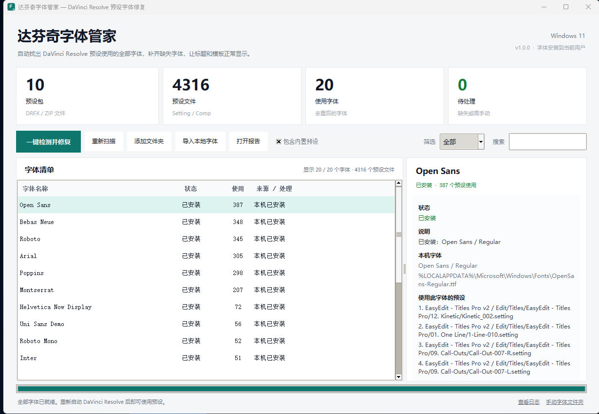

# 达芬奇字体管家 · Resolve Font Doctor

自动检测 DaVinci Resolve / Fusion 预设里用到的字体，检查本机是否已安装，并自动下载、安装缺失的开源字体。  
为 Windows 10/11 设计，同时保留 macOS / Linux 源码支持。



## 下载

从 [GitHub Releases](https://github.com/Qikowali/resolve-font-doctor/releases) 下载：

- `ResolveFontDoctor.exe`：Windows 单文件 GUI
- `ResolveFontDoctor-v1.0.0-Windows.zip`：GUI + CLI + README + 截图
- `ResolveFontDoctor-CLI.exe`：命令行版，适合批处理

也可以从源码运行，见下方“从源码运行 / 构建”。

## 它解决什么问题

很多标题、转场、Toko / EasyEdit 等预设包会引用别的字体。字体缺失时，DaVinci Resolve 不会提示具体缺了哪一个，只会用默认字体替代，导致版式、字重、行宽全部变样。

本工具会：

1. 扫描 Resolve 的内置预设和用户预设（`.drfx`、`.zip`、`.setting`、`.comp`）；
2. 从 Fusion 文本节点的 `Font` / `FontName` 字段、以及 `font-family` 样式里提取字体名；
3. 读取本机已安装字体（解析 TTF/OTF/TTC 的字体名称表，不靠文件名猜）；
4. 对缺失字体到 Google Fonts 查找开源字体并下载；
5. 把字体安装到**当前用户**（无需管理员权限），写入注册表并刷新系统字体缓存；
6. 生成 HTML / JSON / CSV 报告，列出每个字体被哪些预设使用、处理结果和官方获取入口。

## 快速开始

1. 双击 `ResolveFontDoctor.exe`（或 `达芬奇字体管家.exe`）。
2. 等待自动扫描完成。顶部卡片会显示预设包、预设文件、使用字体和待处理数量。
3. 点击 **一键检测并修复**。
4. 修复完成后，**完全退出 DaVinci Resolve，再重新启动**，打开预设即可。

安装过程只写入当前用户目录和 `HKCU` 注册表，不需要管理员权限。字体默认安装到：

```
%LOCALAPPDATA%\Microsoft\Windows\Fonts
```

> 程序未做商业代码签名，首次运行时 Windows SmartScreen 可能提示“已保护你的电脑”。  
> 点击“更多信息 → 仍要运行”即可；也可以直接从源码运行 `python run_gui.py`。

## 字体来源与授权

- **自动下载**：只下载 Google Fonts 上采用 OFL / Apache / UFL 等开源授权的字体，并保留授权文件。
- **商业字体 / 演示版 / 系统专属字体**：不会进行未授权下载。报告和界面会给出官方获取入口，例如：
  - Gilroy：Tinkov Type / Fontspring
  - Helvetica Now Display：Monotype
  - Uni Sans：Fontfabric（演示版）
  - Monument Extended：Pangram Pangram
  - Kozuka Gothic Pr6N：Adobe Fonts
  - PingFang SC：Apple 系统字体，Windows 上需合法授权
- **手动获取字体后**：把 `.ttf` / `.otf` / `.ttc` 放进“手动添加字体”文件夹，点击 **导入本地字体** 即可安装并重新扫描。

> 本工具不会修改预设文件，也不会替换字体名称。它只负责把预设要求的字体安装到系统中。

## 支持范围

### 预设位置

Windows：

```
%APPDATA%\Blackmagic Design\DaVinci Resolve\Support\Fusion\Templates
%PROGRAMDATA%\Blackmagic Design\DaVinci Resolve\Support\Fusion\Templates
%PROGRAMDATA%\Blackmagic Design\DaVinci Resolve\Fusion\Templates
%PROGRAMFILES%\Blackmagic Design\DaVinci Resolve\Fusion\Templates
```

macOS / Linux 的常见路径也会自动发现。找不到时，点击 **添加文件夹**，选择存放 `.drfx` / `.setting` 的目录即可。

### 字体格式

- 解析：TTF、OTF、TTC、OTC（读取 `name` 表，支持多语言名称和可变字体）
- 安装：TTF、OTF、TTC、OTC
- 预设：`.drfx`、`.zip`、`.setting`、`.comp`（含压缩包内的 Setting）

## 命令行

适合批处理或排查问题：

```powershell
# 只扫描，不联网
ResolveFontDoctor-CLI.exe --offline --verbose

# 扫描 + 自动下载安装
ResolveFontDoctor-CLI.exe --install

# 指定额外的预设文件夹
ResolveFontDoctor-CLI.exe --root "D:\My Resolve Presets" --install

# 不扫描内置预设
ResolveFontDoctor-CLI.exe --no-builtin --install
```

退出码：`0` 全部就绪，`1` 仍有缺失或需手动处理，`2` 运行错误。

## 从源码运行 / 构建

需要 Python 3.10+，无第三方运行时依赖（Tkinter 为 Python 自带）。

```powershell
python run_gui.py
python run_cli.py --offline --verbose
python -m unittest discover -s tests -v
```

构建 Windows 单文件程序：

```powershell
.\build.ps1 -Python "C:\Path\To\python.exe"
```

产物在 `dist\ResolveFontDoctor.exe` 和 `dist\ResolveFontDoctor-CLI.exe`。

## 常见问题

**修复后 Resolve 里还是旧字体？**  
必须先完全退出 Resolve（包括后台进程），再启动。字体列表是启动时读取的。

**报告显示“需手动获取”怎么办？**  
这是商业字体或系统专属字体。点击界面里的 **打开获取页面**，按官方授权获取后，把字体文件拖进“手动添加字体”文件夹，再点 **导入本地字体**。

**预设里的字体名和实际字体家族名不一致？**  
工具会按字体内部名称、PostScript 名称、注册表名称和常见样式后缀做匹配；仍不匹配时会在报告中标出。可以点 **复制名称**，用字体查看器确认实际家族名。

**会修改我的预设吗？**  
不会。扫描是只读的，安装只发生在系统字体目录。

## 项目结构

```
src/resolve_font_doctor/
  presets.py       # 预设发现、DRFX/ZIP、Setting 字体提取
  font_files.py    # 纯 Python sfnt/name 表解析
  system_fonts.py  # 本机字体索引与名称匹配
  google_fonts.py  # Google Fonts 元数据、下载、镜像回退
  installer.py     # Windows/macOS/Linux 字体安装
  service.py       # 扫描 → 分析 → 修复流程
  report.py        # HTML / JSON / CSV 报告
  gui.py           # 中文 Tkinter 界面
  cli.py           # 命令行
```

## 许可

本工具源码使用 MIT License。下载的字体遵循各自的授权（多为 SIL OFL），授权文件保存在下载缓存目录中。
